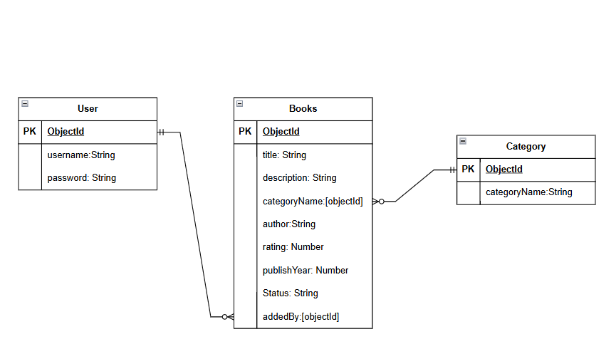

# Amber Archive - Book Library Management System

## Technologies Used
* HTML
* CSS
* JavaScript
* Node.js
* MongoDB 

## Description
Amber Archive is a fall-inspired Book Library Management System designed to make organizing and managing books simple and efficient. With a warm autumn aesthetic, it allows users to browse the collection, manage book records, and keep track of borrowing and returns in a cozy, welcoming digital space.

## User Stories
1. As a user (Librarian), I want to be able to add new books, so I can keep the library collection updated.
2. As a user (Librarian), I want to be able to view all books, so I can easily browse the library collection.
3. As a user (Librarian), I want to be able to edit book details, so I can keep the information accurate.
4. As a user (Librarian), I want to be able to delete books, so I can remove outdated or unwanted records.
5. As a user (Librarian), I want to be able to delete books, so I can remove outdated or unwanted records.
6. As a user (Reader), I want to be able to view book details, so I can learn more about a book before borrowing it.
7. As a user (Reader), I want to be able to view book details, so I can learn more about a book before borrowing it.
8. As a user (Librarian), I want to be able to view borrowing records, so I can monitor borrowed and returned books.

## Database Design (ERD)

## Routes

| Method | Route               | Description                     |
|--------|---------------------|---------------------------------|
| GET    | /                   | Home Page                       |
| GET    | /404-page           | 404 Error Page                  |
| GET    | /new                | New Create Book form            |
| POST   | /new                | Create Book                     |
| GET    | /dashboard          | Dashboard Page                  |
| DELETE | /:bookId            | Delete Book                     |
| GET    | /:bookId/edit       | Edit book info form             |
| PUT    | /:bookId            | Upadte Book info                |
| GET    | /full-shelf/:status | View books list based on status |

## Screenshots

## Future Enhancements

## Credits

### Development & Tools
- **Frameworks & Libraries:** Express.js, Mongoose, EJS

